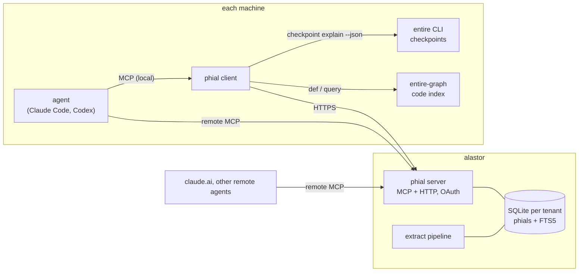
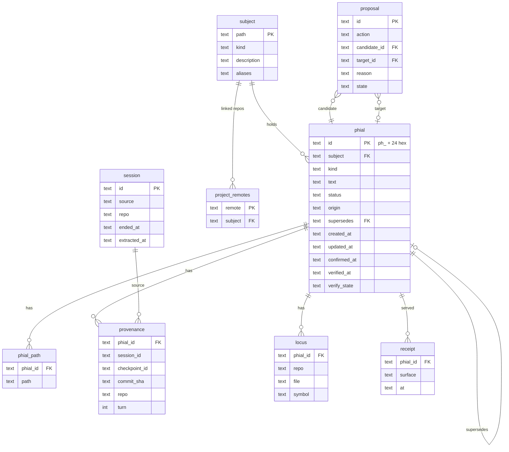
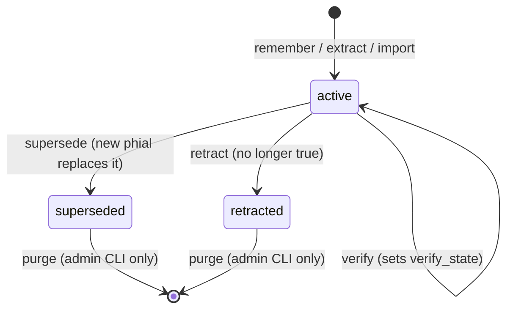
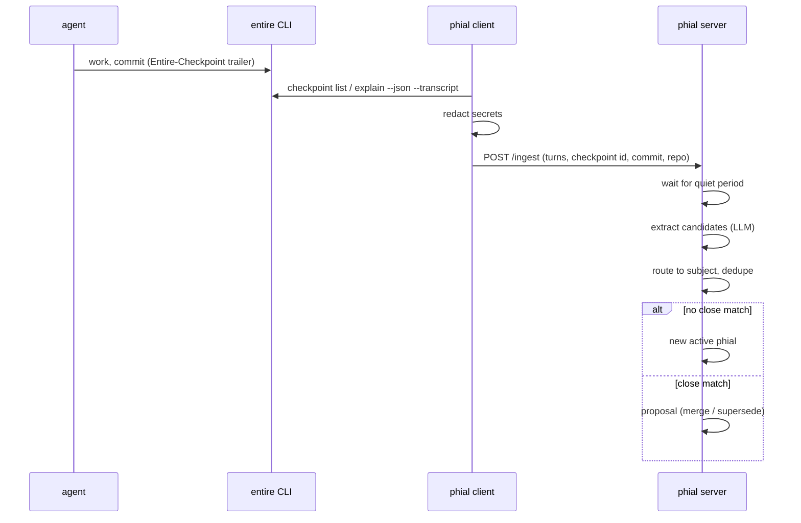

# phial design

Status: draft, 2026-10-31.

phial is a memory server for coding agents and chat agents. It replaces lard. Each memory is one
record, a **phial**. The server keeps phials for every machine and every agent, and it serves them
over MCP (Model Context Protocol) and HTTP.

The record model comes from [entire-brain](https://github.com/entireio/entire-brain). The transport
and the subject layout come from [lard](https://tangled.org/dunkirk.sh/lard). Code checks come from
[entire-graph](https://github.com/entireio/entire-graph), and they run on the client.

## 1. Goals

1. One memory store for all machines (remus, dippet, alastor, others) and all agents (Claude Code,
   Codex, claude.ai, Crush).
2. One record per fact, with an ID, a kind, a status and a source.
3. A fact that is no longer true is superseded or retracted. It is not silently rewritten.
4. Each fact can point to the session, the Entire checkpoint and the commit that produced it.
5. Each fact about code can point to a file or a symbol, and the client can check that it still
   exists.
6. Agents get a small context first and read more only when they need it.
7. All of lard's current memory comes across on day one.

## 2. Non-goals

- phial does not index code. entire-graph does that on each client.
- phial does not store full transcripts for search. It stores the extracts and a pointer to the
  source.
- phial does not use embeddings. Recall is BM25 (keyword ranking) through SQLite FTS5.
  entire-brain removed semantic search, and lard never had it.
- phial is not a hosted product. Users are the identities one authorization server vouches for
  and the operator allows.

## 3. Concepts

| Term | Meaning |
| --- | --- |
| phial | One memory record: one durable statement. |
| subject | The thing a phial is about: `profile`, `areas/<name>`, `topics/<name>`, `people/<name>`. Same set as lard. |
| path | A dotted taxonomy path inside a subject, for example `deploy.target`. A phial has one or more paths. |
| kind | `decision`, `invariant`, `gotcha`, `preference`, `convention`, `fact`. `fact` covers identity and plain descriptions, which entire-brain does not need. |
| scope | `global` (profile, topics, people) or `area` (one project). A global phial in a project context is labelled `(global)`. |
| status | `active`, `superseded`, `retracted`. |
| origin | `authored` (an agent or a person called `remember`), `extracted` (the pipeline found it in a session), `imported` (from lard). |
| provenance | Where the phial came from: session ID, Entire checkpoint ID, commit SHA, repo. |
| locus | Optional code anchor: a repo-relative path and an optional symbol, for example `internal/store/store.go#ListSubjects`. |
| proposal | A queued merge or supersede that waits for review. |
| receipt | A record that a read surface served a phial to an agent. |
| user | One identity (an OAuth `sub`), with its own store. Only identities in `auth.allowed_users` get one. |
| pool | A shared store with members and readers. It owns subjects (`areas/crane` and its children). |
| view | One identity's merged picture: its own store plus its pools. |
| ledger | The change log: who did what to which phial, when, with the text before and after. |

## 4. Architecture



The server owns phials. The client owns everything that needs a checkout: session upload, `verify`
and `brief`. An agent can use the server directly over remote MCP, or use the local client, which
adds code context.

## 5. Data model

SQLite, one database per tenant, as in lard. The format is fixed from the first release. A
schema change is a numbered migration, not a new storage layout.



Notes:

- `phial_fts` is an FTS5 table over `text`, the paths, and the subject description.
- `verify_state` is `ok`, `moved`, `stale`, `orphaned` or `unverifiable`. The client sets it. The
  server only stores it.
- The project registry is `project_remotes`: a normalized git remote (`github.com/owner/repo`)
  names one area subject. `get_context` tries the remote first, then the workspace name against
  area names and aliases, and links the remote when the name matches.
- Migration `001_init.sql` holds every table above except `session` and `proposal`, which come
  with milestones 4 and 5. The store also keeps `purge_log` (ID, reason, time; never the text).
- Backups: `phial backup <dir>` writes the SQLite files and an NDJSON export, one phial per line.
  The NDJSON format is versioned and is the import format too.

### 5.1 Users, pools and the ledger

```text
<data_dir>/
  users/<slug>/phial.db     one store per identity; slug = readable part + hash of the sub
  users/<slug>/identity     the sub, so the worker can list users
  pools/<name>/phial.db     one store per shared pool
```

- Every request carries an identity: the OAuth `sub` in mode `oauth`, or `primary_user` in mode
  `token` and `none`. The identity's **view** fans every read out over its own store and its pools,
  merges by score, and tags each result with its pool. A write goes to the pool that owns the
  subject when the identity is a member, to the user's own store otherwise, and fails with
  "read only" for a reader.
- Pools are config (`[[pools]]`, or the Nix module), so adding a member is a deploy, not a UI
  action. Members read and write; readers read.
- Every phial records `created_by`. Every write appends a **ledger** row in the same transaction:
  actor, action (`remember`, `confirm`, `supersede`, `retract`, `verify`, `propose`, `review`,
  `purge`), phial, subject, text before, text after, note. The UI shows the ledger as an activity
  feed with word diffs, per phial, per subject and per actor; the `changes` MCP tool shows the
  same. Purge empties the text in the purged phial's older rows.
- The ledger is the system of record for history. A git mirror of the rendered markdown, one
  commit per ledger row with the actor as author, is a possible later export; it is not needed for
  "who changed what and when".

## 6. Lifecycle



Rules:

1. `remember` with text identical to an active phial in the same subject returns the existing
   phial. It does not make a copy. It sets `confirmed_at` on that phial to the current time.
2. When extraction finds a candidate that is close to an active phial, it does not change that
   phial. It makes a proposal (`merge` or `supersede`) and keeps the candidate pending.
3. An agent call to `supersede` with an explicit target applies at once. The agent named the
   target, so no review is needed.
4. phial keeps every phial forever. There is no retention window and no `gc`. Superseded and
   retracted phials are hidden from default reads, and `recall --all` shows them as history.
   Old and stale active phials are not deleted either. They rank lower (section 7.1).
5. The one way to remove a phial is `phial purge <id>` on the server CLI. It is for a phial that
   must not exist, for example one that holds a secret. It is not an MCP tool, so no agent can
   call it. It writes an audit line with the ID, the time, the reason and a hash of the subject and
   text, but not the text. The hash stops an import from bringing the phial back. The store runs
   with `secure_delete`, the full-text index uses FTS5 `secure-delete`, and a purge ends with
   `VACUUM` and a WAL checkpoint, so the text is gone from the live files. Backups made before
   the purge still hold it: purge those too.

## 7. Read surfaces

The server exposes MCP and HTTP. The MCP tools:

| Tool | Purpose |
| --- | --- |
| `get_context` | Session start. Returns the profile phials, the project's area outline, and the subject index. It returns an outline, not whole files. |
| `recall` | Search, ranked as in section 7.1. Filters: `subject`, `kind`, `path` prefix, `scope`, `locus`, `status`. Returns phials with IDs, `(global)` labels, and age and stale labels. `explain: true` adds the score parts. |
| `outline` | The tree for a subject or path prefix, at depth 1 to 3. |
| `read` | One subject rendered as markdown from its active phials. Same shape as lard's `memory_read`, so old prompts keep working. |
| `remember` | Make a phial. Arguments: `text`, `subject`, `kind`, `paths`, optional `locus`, `session_id`, `checkpoint_id`. |
| `supersede` | Replace a phial with new text. |
| `retract` | Mark a phial as no longer true, with a reason. |
| `confirm` | Record that a phial is still true. Sets `confirmed_at`, which resets its age for ranking. |
| `review` | List, apply or reject pending proposals. |

Each read records a receipt. `phial vitality` shows phials that agents never get. These are
candidates to retract or to rewrite with better paths.

The client adds two tools to its local MCP server:

| Tool | Purpose |
| --- | --- |
| `brief` | `recall` on the server plus `entire graph query` on the checkout, merged into one bounded packet. |
| `verify` | Checks each locus in the current repo with entire-graph, then reports the result to the server. |

### 7.1 Ranking

phial keeps every phial, so ranking does the work that deletion does in other tools. An old or
stale phial ranks lower, but it can always come back.

```text
score = relevance × freshness × trust
```

**relevance** is the BM25 score from FTS5, normalized to 0..1 for the query. Reads with no query,
such as `get_context` and `outline`, use 1.

**freshness** depends on the age of the phial and on its kind:

```text
age       = now − max(confirmed_at, updated_at)
freshness = max(floor, 0.5 ^ (age / half_life))
```

| Kind or subject | half_life | floor |
| --- | --- | --- |
| `profile` subject | none (freshness is always 1) | 1 |
| `invariant`, `convention`, `preference` | 2 years | 0.5 |
| `decision` | 1 year | 0.4 |
| `fact` | 180 days | 0.3 |
| `gotcha` | 180 days | 0.3 |

The floor makes sure that an old phial that matches a query well still comes back. Age starts again
when a phial is confirmed, which happens in three ways:

1. An agent calls `confirm`.
2. `remember` or extraction produces the same text again.
3. `verify` sets `verify_state` to `ok`.

**trust** comes from `verify_state`:

| verify_state | trust | Label in results |
| --- | --- | --- |
| `ok` | 1.0 | none |
| `unverifiable` | 0.9 | none |
| `moved` | 0.7 | `(moved: <old path>)` |
| `stale` | 0.3 | `(stale: <symbol> not found)` |
| `orphaned` | 0.2 | `(orphaned: repo not found)` |

Rules:

1. Results always carry an age label, for example `(confirmed 8 months ago)`, so an agent can judge
   an old phial itself.
2. `get_context` and `outline` show the top phials for each subject by score. They fold the rest
   into one line, for example `+12 older phials, use recall`.
3. Receipts do not change the score. A phial that is served often would rank higher, then be served
   more often, and it would never go down. Receipts are for the `vitality` report only.
4. The half-lives, floors and trust values live in config, not in code, so they can be tuned
   without a migration.
5. `phial rank-report` lists the active phials with the lowest scores. They are candidates to
   confirm, rewrite or retract.

### 7.2 Proposals and review

Extraction (section 8) never edits an active phial. When a candidate restates one (same text) it
confirms it. When a candidate is close to one (word overlap of 0.6 or more) it files a
**proposal**: a supersede that waits for a person. `review` (MCP) and the Proposals page (UI)
list them with a diff; apply supersedes the target, reject keeps it. Both are ledger rows.

## 8. Write path: sessions



- The client reads Entire checkpoints first. For repos without Entire, it falls back to the raw
  Claude Code and Codex transcript files, as lard does.
- Redaction runs on the client, before upload. Session text is untrusted input to the extractor.
- Extraction runs on the server, not on the client. The server calls an OpenAI-compatible endpoint
  with its own API key (`PHIAL_LLM_API_KEY`, from agenix on alastor). Extraction runs when no
  client is on, and clients do not need an agent or a model key.
- Extraction keeps lard's prompt rules: durable facts only, concrete specifics, the sensitivity
  blocklist, and routing to existing subjects. The output is phials, not rewritten files.

## 9. Import from lard

```text
phial import lard --dir <lard memory dir>        # dry run: counts per subject, writes nothing
phial import lard --dir <lard memory dir> --apply
phial import lard --url <lard url> --token-file <file> --apply
```

`--dir` reads lard's subject files from disk: a lard `memory_dir`, or one tenant of a
`lard backup` tree (a folder that holds `memory/`). `--url` reads a running lard over HTTP:
`GET /memory`, then `GET /memory/{path}?format=json` for each subject, with a bearer token.

- Each top-level bullet becomes one phial with `origin: imported` and kind `fact`, in the same
  subject. Indented lines under a bullet belong to it.
- A tag such as `[stated]` or `[observed 2026-09-11]` is removed from the text and kept in the
  source line (`lard:areas/infra [stated]`). A date in the tag, or a leading `2026-10-14:`, becomes
  `created_at`. A bullet with no date takes the subject's `updated` time.
- `confirmed_at` is the same as `created_at`, so an old fact does not look freshly confirmed. The
  ranking in section 7.1 then places it by its real age.
- A markdown heading above bullets becomes a one-segment path on them (`## Build` gives `build`).
- Subject descriptions and aliases come across as they are. `repos` link the area to its remotes.
- `[[links]]` stay in the text.
- The import is idempotent: a bullet whose text already exists in the subject, in any status, is
  skipped. A phial that was imported and later superseded is not brought back.
- A subject whose path is not valid in phial is reported and skipped. The others still import.
- `verify` reports imported phials as `unverifiable` until a person or agent adds a locus. That is
  expected.

### 9.1 Import from entire-brain

`phial-client sync` also exports each local entire-brain (`entire brain memories files`) for the
repos under its roots and sends every active memory to phial as a phial in `areas/<repo>` with
`origin: imported` and the source `entire-brain:<id>`. The client remembers the ids it sent, and
`remember` is idempotent by text, so a re-run sends nothing twice. It is one way: phial never
writes into the brain.

## 10. Web UI

The server also serves a browser UI at `/`, for a person to read and tend the memory.

| Screen | Path | Job |
| --- | --- | --- |
| Overview | `/` | Counts, the lowest-level phials, the recent changes, and every subject. |
| Subject | `/s/<subject>` | The subject's phials by level, with its paths, repos and children. |
| Search | `/search` | Recall with every filter. |
| Needs attention | `/low` | Active phials under level 0.5 or with a failed code check. |
| Phial | `/p/<id>` | Level and its parts, record, sources, history. Confirm, supersede, retract. |
| Remember | `/remember` | Make a phial. |
| Activity | `/activity` | The ledger: every change with its actor and a diff; filter by subject or actor. |
| Proposals | `/proposals` | Changes extraction proposed; apply or reject. |

- The UI is server-rendered HTML with no JavaScript. The CSP is `default-src 'none'` with
  `style-src`, `img-src` and `font-src` set to `'self'`. Fonts (IBM Plex, SIL OFL) are served by
  phial itself.
- **Sign-in.** With `ui_login = token`, `/login` takes the server token and signs in as
  `primary_user`. With `ui_login = oauth`, `/login` sends the browser to the authorization server
  (authorization code with PKCE) and `/auth/callback` signs in as the token's `sub`, if allowed.
  Either way the session cookie is HttpOnly, `SameSite=Strict`, `Secure` when `public_url` is
  https, valid for 30 days, and signed with a key derived from the token, so a new token signs
  every session out.
- **Forms.** Every POST needs the session and a CSRF token from the page. An `Origin` header must
  equal the origin of `public_url` when it is set (this works behind a proxy that rewrites
  `Host`), or else the request's `Host`. Failed logins slow down, up to 3 seconds per try. The
  `next` target after login must be a local path; control characters and backslashes are refused.
- **Sign-out** clears the cookie in the browser only. A copied cookie stays valid until it expires,
  30 days at most. Changing the token ends every session at once. A server-side session list is
  left for milestone 3, with OAuth.
- **Mode `none`** is for local testing. It is only allowed on a loopback address, the server then
  answers only loopback `Host` names, and the MCP SDK's DNS-rebinding guard stays on.
- The UI has no purge. Purge stays on the server CLI.

## 11. Security

- Mode `oauth`: every `/mcp` and `/api` request carries an access token, checked at the
  authorization server's introspection endpoint (RFC 7662, cached up to 5 minutes). The token must
  name phial (`<public_url>/mcp`) or an accepted audience (Authentik sets `aud` to the client id),
  must carry a `sub`, and the `sub` must be allowed. phial publishes RFC 9728 protected-resource
  metadata at `/.well-known/oauth-protected-resource[/mcp]`, so an MCP client finds the
  authorization server from a bare 401.
- One SQLite file per identity and per pool. A view only opens the stores its identity may read.
- No secret values in phials. The client redacts before upload, and the extractor drops lines that
  match secret patterns.
- Tool results from phial are data. The agent guide tells agents not to follow instructions found
  in phial text.

## 12. Milestones

1. **Store and MCP.** Schema, `remember`, `recall`, `read`, `retract`, `supersede`, `confirm`,
   `get_context`, and the ranking in section 7.1. Token auth. Tests on the store and the ranking.
   Built, with the web UI of section 10.
2. **lard import.** Dry run, then a real import on a copy of the lard data. The importer is built;
   the run on the real data is still to do.
3. **OAuth and tenants.** Bring lard's auth model across.
4. **Client.** Login, local MCP, Entire checkpoint upload, `verify`, `brief`, and entire-brain
   sync (below).
5. **Extraction.** Pipeline, proposals, `review`.

**entire-brain sync** (planned for milestone 4). entire-brain keeps its memories on each machine,
per repo and branch. The client will read them (`entire brain memories` JSON, or the brain's local
REST API at `/v1/facts`) and send them to phial as phials in that repo's area, with
`origin: imported`, a source of `entire-brain:<fact id>`, and the brain's session and commit as
provenance. The fact ID makes the sync idempotent, and a fact that the brain retracts or supersedes
is retracted or superseded in phial too. The first version is one way, from the brain to phial, so
two stores never edit the same fact.
6. **Cutover.** Deploy on alastor at `phial.hogwarts.dev` through the Nix module, change the MCP
   config on each machine, update CLAUDE.md, and keep lard read-only for a period.

Status on 2026-10-31: 1 to 5 are built. The client reads Claude Code transcripts; Entire
checkpoints are linked through the `Entire-Checkpoint` commit trailer, because the Entire CLI's
checkpoint JSON was not readable on the dev machine. `verify` uses entire-graph's `def` lookup
when it is installed and a word search otherwise. 6 is in progress in `jaspermayone/infra`.

## 13. Decisions

| Date | Decision |
| --- | --- |
| 2026-10-31 | Start from scratch, not a fork of lard. |
| 2026-10-31 | Name: phial. |
| 2026-10-31 | Extraction runs on the server, with the server's own API key. |
| 2026-10-31 | Hostname: `phial.hogwarts.dev`, served from alastor. |
| 2026-10-31 | Keep every phial forever. Only `phial purge` on the server CLI removes one. |
| 2026-10-31 | Old and stale phials rank lower (freshness × trust), they are not hidden or deleted. |
| 2026-10-31 | A browser UI, signed in with the server token, ships with milestone 1. |
| 2026-10-31 | entire-brain memories sync into phial, one way, from the client (milestone 4). |
| 2026-10-31 | One store per user; only allowed users get one. Shared pools with members and readers, config-managed. |
| 2026-10-31 | Every phial records its author, and every write is a ledger row with before and after text. |
| 2026-10-31 | phial reuses the Authentik provider `lard` (client id `lard`) rather than a new provider. |

## 14. Open questions

None at this time.
