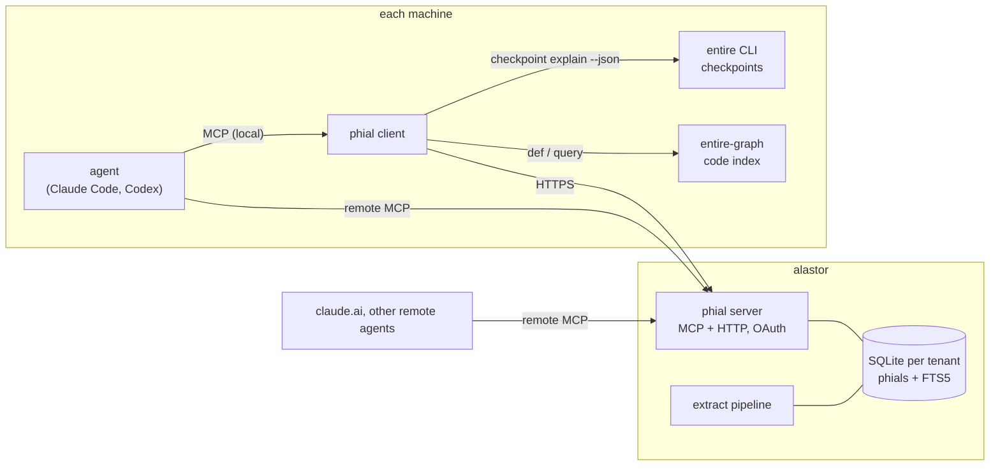
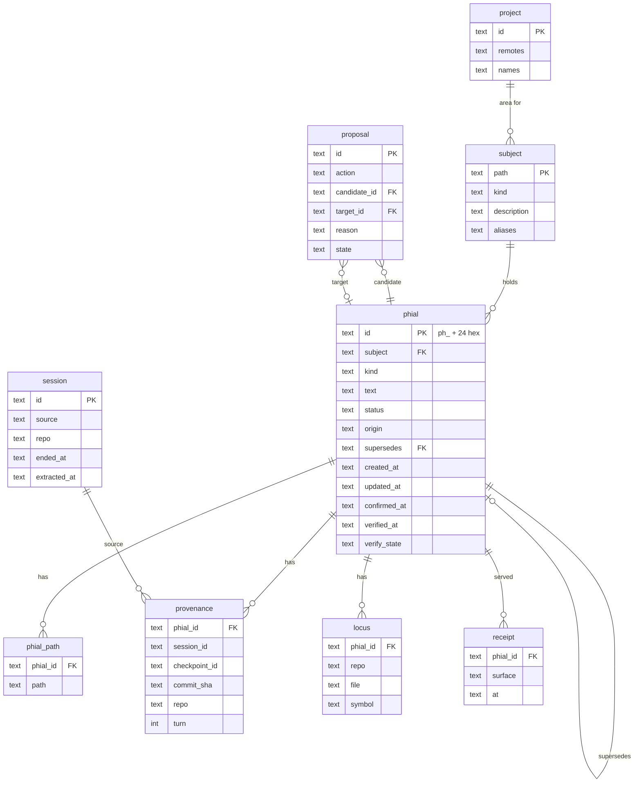
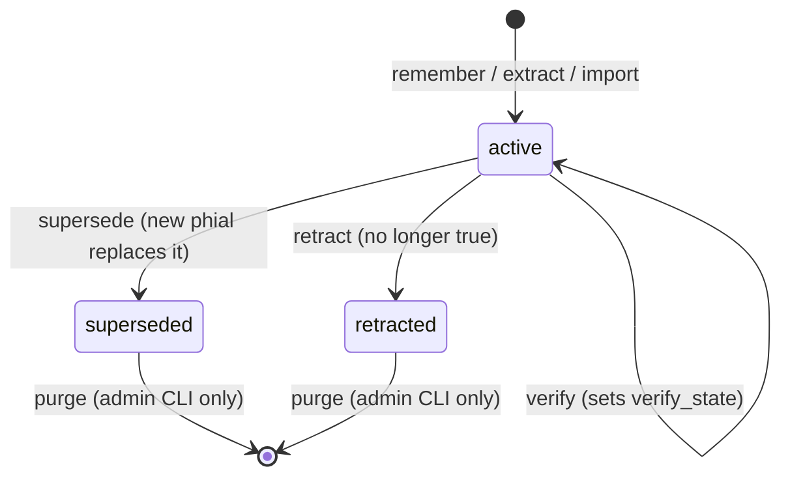
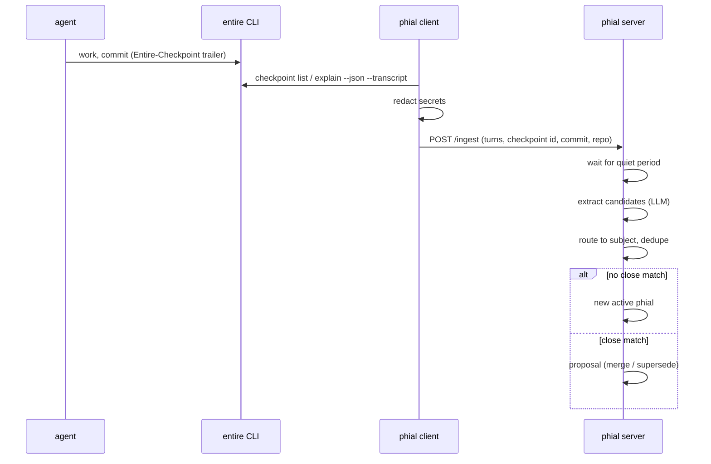

# phial design

Status: draft, 2026-10-31.

phial is a memory server for coding agents and chat agents. It replaces lard. Each memory is one
record, a **phial**. The server keeps phials for every machine and every agent, and it serves them
over MCP (Model Context Protocol) and HTTP.

The record model comes from [entire-brain](https://github.com/entireio/entire-brain). The transport
and the subject layout come from [lard](https://tangled.org/dunkirk.sh/lard). Code checks come from
[entire-graph](https://github.com/entireio/entire-graph), and they run on the client.

## 1. Goals

1. One memory store for all machines (remus, dippet, alastor, others) and all agents (Claude Code,
   Codex, claude.ai, Crush).
2. One record per fact, with an ID, a kind, a status and a source.
3. A fact that is no longer true is superseded or retracted. It is not silently rewritten.
4. Each fact can point to the session, the Entire checkpoint and the commit that produced it.
5. Each fact about code can point to a file or a symbol, and the client can check that it still
   exists.
6. Agents get a small context first and read more only when they need it.
7. All of lard's current memory comes across on day one.

## 2. Non-goals

- phial does not index code. entire-graph does that on each client.
- phial does not store full transcripts for search. It stores the extracts and a pointer to the
  source.
- phial does not use embeddings. Recall is BM25 (keyword ranking) through SQLite FTS5.
  entire-brain removed semantic search, and lard never had it.
- phial is not a team product. It is multi-user only in the sense lard is: one isolated store per
  identity.

## 3. Concepts

| Term | Meaning |
| --- | --- |
| phial | One memory record: one durable statement. |
| subject | The thing a phial is about: `profile`, `areas/<name>`, `topics/<name>`, `people/<name>`. Same set as lard. |
| path | A dotted taxonomy path inside a subject, for example `deploy.target`. A phial has one or more paths. |
| kind | `decision`, `invariant`, `gotcha`, `preference`, `convention`, `fact`. `fact` covers identity and plain descriptions, which entire-brain does not need. |
| scope | `global` (profile, topics, people) or `area` (one project). A global phial in a project context is labelled `(global)`. |
| status | `active`, `superseded`, `retracted`. |
| origin | `authored` (an agent or a person called `remember`), `extracted` (the pipeline found it in a session), `imported` (from lard). |
| provenance | Where the phial came from: session ID, Entire checkpoint ID, commit SHA, repo. |
| locus | Optional code anchor: a repo-relative path and an optional symbol, for example `internal/store/store.go#ListSubjects`. |
| proposal | A queued merge or supersede that waits for review. |
| receipt | A record that a read surface served a phial to an agent. |

## 4. Architecture



The server owns phials. The client owns everything that needs a checkout: session upload, `verify`
and `brief`. An agent can use the server directly over remote MCP, or use the local client, which
adds code context.

## 5. Data model

SQLite, one database per tenant, as in lard. The format is fixed from the first release. A
schema change is a numbered migration, not a new storage layout.



Notes:

- `phial_fts` is an FTS5 table over `text`, the paths, and the subject description.
- `verify_state` is `ok`, `moved`, `stale`, `orphaned` or `unverifiable`. The client sets it. The
  server only stores it.
- The project registry keeps lard's model: git remotes and names resolve to one project ID.
- Backups: `phial backup <dir>` writes the SQLite files and an NDJSON export, one phial per line.
  The NDJSON format is versioned and is the import format too.

## 6. Lifecycle



Rules:

1. `remember` with text identical to an active phial in the same subject returns the existing
   phial. It does not make a copy. It sets `confirmed_at` on that phial to the current time.
2. When extraction finds a candidate that is close to an active phial, it does not change that
   phial. It makes a proposal (`merge` or `supersede`) and keeps the candidate pending.
3. An agent call to `supersede` with an explicit target applies at once. The agent named the
   target, so no review is needed.
4. phial keeps every phial forever. There is no retention window and no `gc`. Superseded and
   retracted phials are hidden from default reads, and `recall --all` shows them as history.
   Old and stale active phials are not deleted either. They rank lower (section 7.1).
5. The one way to remove a phial is `phial purge <id>` on the server CLI. It is for a phial that
   must not exist, for example one that holds a secret. It is not an MCP tool, so no agent can
   call it. It writes an audit line with the ID, the time and the reason, but not the text.

## 7. Read surfaces

The server exposes MCP and HTTP. The MCP tools:

| Tool | Purpose |
| --- | --- |
| `get_context` | Session start. Returns the profile phials, the project's area outline, and the subject index. It returns an outline, not whole files. |
| `recall` | Search, ranked as in section 7.1. Filters: `subject`, `kind`, `path` prefix, `scope`, `locus`, `status`. Returns phials with IDs, `(global)` labels, and age and stale labels. `explain: true` adds the score parts. |
| `outline` | The tree for a subject or path prefix, at depth 1 to 3. |
| `read` | One subject rendered as markdown from its active phials. Same shape as lard's `memory_read`, so old prompts keep working. |
| `remember` | Make a phial. Arguments: `text`, `subject`, `kind`, `paths`, optional `locus`, `session_id`, `checkpoint_id`. |
| `supersede` | Replace a phial with new text. |
| `retract` | Mark a phial as no longer true, with a reason. |
| `confirm` | Record that a phial is still true. Sets `confirmed_at`, which resets its age for ranking. |
| `review` | List, apply or reject pending proposals. |

Each read records a receipt. `phial vitality` shows phials that agents never get. These are
candidates to retract or to rewrite with better paths.

The client adds two tools to its local MCP server:

| Tool | Purpose |
| --- | --- |
| `brief` | `recall` on the server plus `entire graph query` on the checkout, merged into one bounded packet. |
| `verify` | Checks each locus in the current repo with entire-graph, then reports the result to the server. |

### 7.1 Ranking

phial keeps every phial, so ranking does the work that deletion does in other tools. An old or
stale phial ranks lower, but it can always come back.

```text
score = relevance × freshness × trust
```

**relevance** is the BM25 score from FTS5, normalized to 0..1 for the query. Reads with no query,
such as `get_context` and `outline`, use 1.

**freshness** depends on the age of the phial and on its kind:

```text
age       = now − max(confirmed_at, updated_at)
freshness = max(floor, 0.5 ^ (age / half_life))
```

| Kind or subject | half_life | floor |
| --- | --- | --- |
| `profile` subject | none (freshness is always 1) | 1 |
| `invariant`, `convention`, `preference` | 2 years | 0.5 |
| `decision` | 1 year | 0.4 |
| `fact` | 180 days | 0.3 |
| `gotcha` | 180 days | 0.3 |

The floor makes sure that an old phial that matches a query well still comes back. Age starts again
when a phial is confirmed, which happens in three ways:

1. An agent calls `confirm`.
2. `remember` or extraction produces the same text again.
3. `verify` sets `verify_state` to `ok`.

**trust** comes from `verify_state`:

| verify_state | trust | Label in results |
| --- | --- | --- |
| `ok` | 1.0 | none |
| `unverifiable` | 0.9 | none |
| `moved` | 0.7 | `(moved: <old path>)` |
| `stale` | 0.3 | `(stale: <symbol> not found)` |
| `orphaned` | 0.2 | `(orphaned: repo not found)` |

Rules:

1. Results always carry an age label, for example `(confirmed 8 months ago)`, so an agent can judge
   an old phial itself.
2. `get_context` and `outline` show the top phials for each subject by score. They fold the rest
   into one line, for example `+12 older phials, use recall`.
3. Receipts do not change the score. A phial that is served often would rank higher, then be served
   more often, and it would never go down. Receipts are for the `vitality` report only.
4. The half-lives, floors and trust values live in config, not in code, so they can be tuned
   without a migration.
5. `phial rank-report` lists the active phials with the lowest scores. They are candidates to
   confirm, rewrite or retract.

## 8. Write path: sessions



- The client reads Entire checkpoints first. For repos without Entire, it falls back to the raw
  Claude Code and Codex transcript files, as lard does.
- Redaction runs on the client, before upload. Session text is untrusted input to the extractor.
- Extraction runs on the server, not on the client. The server calls an OpenAI-compatible endpoint
  with its own API key (`PHIAL_LLM_API_KEY`, from agenix on alastor). Extraction runs when no
  client is on, and clients do not need an agent or a model key.
- Extraction keeps lard's prompt rules: durable facts only, concrete specifics, the sensitivity
  blocklist, and routing to existing subjects. The output is phials, not rewritten files.

## 9. Import from lard

`phial import lard --url <lard>` reads `GET /memory` and each `GET /memory/{path}`.

- Each top-level bullet becomes one phial with `origin: imported`, in the same subject.
- A `[stated]` tag maps to kind `fact`. A bullet that starts with a date keeps the date as
  `created_at`.
- `[[links]]` stay in the text.
- Subject descriptions and aliases come across as they are.
- `verify` reports imported phials as `unverifiable` until a person or agent adds a locus. That is
  expected.

The import runs as a dry run first and reports counts per subject.

## 10. Security

- OAuth on the remote MCP endpoint, with token audience checks (RFC 8707), as lard has now.
- One SQLite file per identity. No query crosses tenants.
- No secret values in phials. The client redacts before upload, and the extractor drops lines that
  match secret patterns.
- Tool results from phial are data. The agent guide tells agents not to follow instructions found
  in phial text.

## 11. Milestones

1. **Store and MCP.** Schema, `remember`, `recall`, `read`, `retract`, `supersede`, `confirm`,
   `get_context`, and the ranking in section 7.1. Token auth. Tests on the store and the ranking.
2. **lard import.** Dry run, then a real import on a copy of the lard data.
3. **OAuth and tenants.** Bring lard's auth model across.
4. **Client.** Login, local MCP, Entire checkpoint upload, `verify`, `brief`.
5. **Extraction.** Pipeline, proposals, `review`.
6. **Cutover.** Deploy on alastor at `phial.hogwarts.dev` through the Nix module, change the MCP
   config on each machine, update CLAUDE.md, and keep lard read-only for a period.

## 12. Decisions

| Date | Decision |
| --- | --- |
| 2026-10-31 | Start from scratch, not a fork of lard. |
| 2026-10-31 | Name: phial. |
| 2026-10-31 | Extraction runs on the server, with the server's own API key. |
| 2026-10-31 | Hostname: `phial.hogwarts.dev`, served from alastor. |
| 2026-10-31 | Keep every phial forever. Only `phial purge` on the server CLI removes one. |
| 2026-10-31 | Old and stale phials rank lower (freshness × trust), they are not hidden or deleted. |

## 13. Open questions

None at this time.
